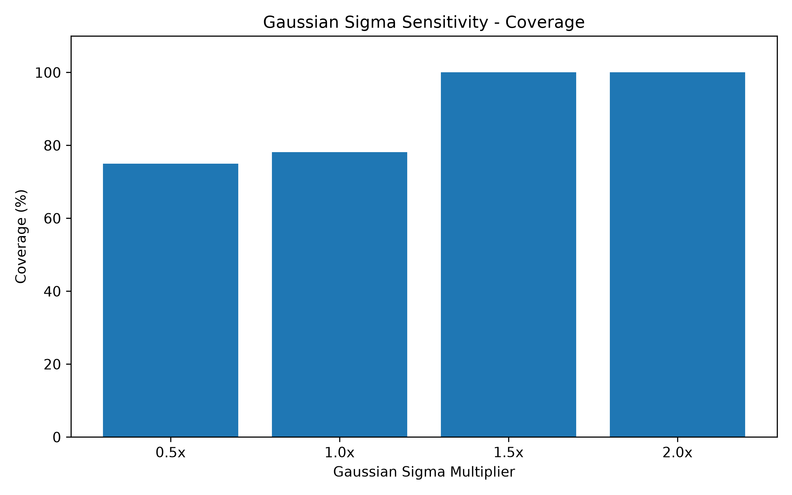
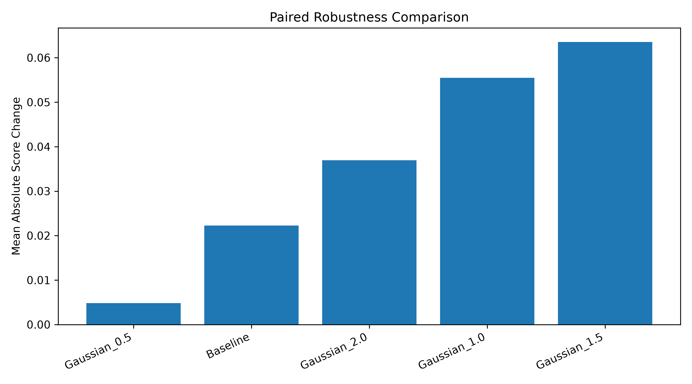
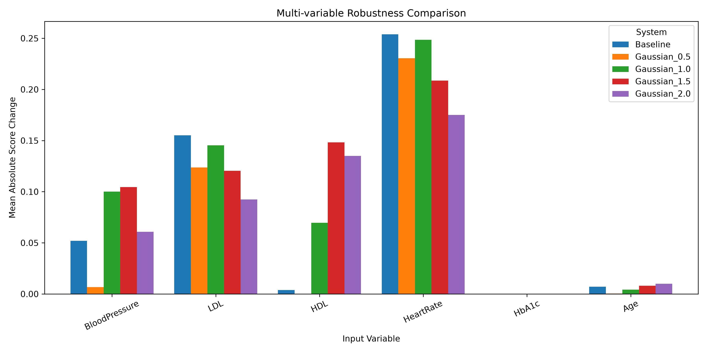

# Heart Disease Risk Assessment Using Fuzzy Logic

## Project Information

- Course: Fuzzy Logic
- Project Type: Reference Paper Reproduction and Experimental Extension
- Student: Umut Çeçen
- Student ID: 1306230108
- Language: Python

## 1. Project Overview

This project implements and experimentally extends a Mamdani fuzzy inference system for heart disease risk assessment.

The reference study is:

Ali, M. L., Sadi, M. S., and Goni, M. O. (2024).
"Diagnosis of heart diseases: A fuzzy-logic-based approach."
PLOS ONE, 19(2), e0293112.
https://doi.org/10.1371/journal.pone.0293112

The project has two main components:

1. Baseline reproduction based on the published fuzzy membership definitions and available rule dataset.
2. An experimental extension using Gaussian-transition membership functions and sensitivity analysis.

The system is intended for academic experimentation only. It is not a clinically validated diagnostic tool.

## 2. Research Objectives

The objectives of this project are:

- Implement the reference Mamdani fuzzy inference pipeline.
- Examine the publicly available rule and test datasets.
- Identify data inconsistencies and missing rule combinations.
- Evaluate an alternative Gaussian-transition membership design.
- Compare rule coverage and numerical score stability.
- Analyze the effects of rule-activation thresholds.
- Investigate the sensitivity of results to Gaussian width parameters.
- Produce reproducible experiments, tables, and figures.

## 3. Reference Fuzzy System

### 3.1 Input Variables

The system uses seven input variables:

| Variable      | Description              |
| ------------- | ------------------------ |
| ChestPain     | Chest pain category      |
| HbA1c         | Glycated hemoglobin      |
| HDL           | High-density lipoprotein |
| LDL           | Low-density lipoprotein  |
| HeartRate     | Heart rate               |
| Age           | Patient age              |
| BloodPressure | Blood pressure           |

### 3.2 Output Categories

The fuzzy output contains four categories:

- Healthy
- LowRisk
- MediumRisk
- HighRisk

The output domain is represented numerically from 0 to 10.

### 3.3 Mamdani Inference Pipeline

The implemented processing sequence is:

1. Fuzzification of the input values.
2. Evaluation of IF-THEN rules using the MIN operator.
3. Aggregation of rule outputs using the MAX operator.
4. Construction of the aggregated fuzzy output.
5. Defuzzification and calculation of a numerical risk score.

The implementation includes:

- Centroid
- Weighted Average (WA)
- Sum of Area (SA)
- Mean of Maxima (MM)

The reported final score uses the arithmetic mean of WA, SA, and MM.

The exact internal definitions of some defuzzification procedures are not fully specified in the reference article. The implementation therefore documents its own computational assumptions.

## 4. Data Sources and Preprocessing

The original datasets were obtained from the Supporting Information of Ali et al. (2024).

Reference article:
https://doi.org/10.1371/journal.pone.0293112

### Original Datasets

data/raw/inference_rules_or_training_data_set.csv

data/raw/testing_data_set.csv

### Processed Datasets

data/processed/inference_rules_cleaned.csv

data/processed/parsed_rules.csv

The original datasets are preserved separately from the processed datasets.

### 4.1 Data Quality Findings

The original rule CSV contains an isolated quotation-mark line that interferes with ordinary CSV parsing.

The cleaning process removes this malformed line without modifying the remaining text lines.

After preprocessing:

- Parsed rule records: 4,048
- Rule records with missing output labels: 8
- Rules with usable output labels: 4,040

The reference paper describes 4,320 theoretical rule combinations. The provided file contains fewer records.

Some category names also require normalization, particularly in the LDL variable.

The testing dataset contains categorical IF-THEN expressions rather than the original continuous measurements for individual patients.

Conflicting target labels have also been observed for some identical test conditions.

These limitations prevent a direct, fully validated reproduction of the published patient-level classification accuracy using the available CSV files alone.

### 4.2 Reference Example Discrepancy

For one numerical example in the reference paper, the article describes a final score of approximately 6.44.

Under explicitly selected assumptions for the WA, SA, and MM calculations, this result can be approximately reconstructed using the rule activations described in the article.

However, the published rule CSV assigns different consequent categories to the corresponding conditions.

Consequently, the CSV-driven baseline implementation produces a score of 8.0 for that example.

This discrepancy is documented rather than silently corrected.

## 5. Experimental Extension

### 5.1 Gaussian-Transition Membership Functions

The experimental system replaces the continuous input membership transitions with Gaussian-shaped transitions.

The baseline and experimental systems share:

- The same published rule dataset.
- The same MIN rule-evaluation operator.
- The same MAX aggregation operator.
- The same output membership definitions.
- The same defuzzification calculations.

ChestPain remains a discrete categorical variable.

The experimental implementation preserves full-membership plateau regions and uses Gaussian functions outside those regions.

It should therefore be described as a Gaussian-transition or Gaussian-shoulder design, not as a replacement with ordinary single-peak Gaussian functions.

### 5.2 Sigma Sensitivity

Four sigma multipliers are evaluated:

- 0.5
- 1.0
- 1.5
- 2.0

The sigma multiplier controls the width of the Gaussian transitions.

The reference sigma parameters were selected as experimental design choices. They are not reported as parameters learned from clinical patient data.

### 5.3 Rule-Activation Threshold

For the reported coverage analyses, the minimum rule-activation threshold is:

0.001

An input is considered covered when its maximum rule activation is strictly greater than this threshold.

Unless specifically stated otherwise, the numerical risk scores are calculated using all positive-activation rules.

Thus, numerical score availability and threshold-based coverage are distinct measurements.

## 6. Experimental Design

### 6.1 Synthetic Input Profiles

Experiments use 32 reproducibly generated synthetic profiles.

The profiles are derived from four starting examples:

- Low-risk-oriented profile
- Medium-risk-oriented profile
- High-risk-oriented profile
- Reference-paper numerical example

Eight profiles are generated per starting example.

The random seed is fixed to 42.

These synthetic inputs are not independent clinical patient observations and do not have verified diagnostic ground-truth labels.

### 6.2 Evaluation Metrics

The experimental evaluation considers:

- Threshold-based rule coverage.
- Number of positively activated rules.
- Maximum rule activation.
- Numerical risk score differences.
- Mean absolute score changes after input perturbations.
- Sensitivity to sigma multipliers.

Lower score change indicates less numerical variation under the specified perturbation. It does not necessarily imply greater predictive accuracy.

### 6.3 Multi-Variable Robustness

Six continuous input variables are perturbed separately:

| Variable      | Perturbation |
| ------------- | ------------ |
| BloodPressure | +/- 5        |
| LDL           | +/- 5        |
| HDL           | +/- 5        |
| HeartRate     | +/- 5        |
| HbA1c         | +/- 0.2      |
| Age           | +/- 2        |

ChestPain is excluded from continuous perturbation because it is represented categorically.

The study compares five system configurations:

- Baseline
- Gaussian 0.5
- Gaussian 1.0
- Gaussian 1.5
- Gaussian 2.0

A total of 1,920 modified-input evaluations are recorded.

The final comparisons use matched inputs that are covered by all systems being compared.

## 7. Experimental Results

### 7.1 Sigma-Based Coverage

Coverage was evaluated on the 32 synthetic profiles using the 0.001 activation threshold.

| System       | Covered Profiles | Coverage |
| ------------ | ---------------: | -------: |
| Baseline     |            24/32 |   75.00% |
| Gaussian 0.5 |            24/32 |   75.00% |
| Gaussian 1.0 |            25/32 |   78.13% |
| Gaussian 1.5 |            32/32 |  100.00% |
| Gaussian 2.0 |            32/32 |  100.00% |

These coverage percentages apply only to the synthetic experimental sample.

### 7.2 Matched Robustness Comparison

For the 24 profiles covered by every system, the following mean absolute score changes were observed after a +3 blood-pressure perturbation:

| System       | Mean Absolute Score Change |
| ------------ | -------------------------: |
| Gaussian 0.5 |                   0.004836 |
| Baseline     |                   0.022233 |
| Gaussian 2.0 |                   0.036930 |
| Gaussian 1.0 |                   0.055466 |
| Gaussian 1.5 |                   0.063525 |

Gaussian 0.5 shows the smallest score change under this particular perturbation.

However, Gaussian 0.5 does not provide the highest overall coverage.

### 7.3 Main Finding

Increasing Gaussian transition width can improve threshold-based rule coverage, but it does not uniformly improve score stability.

The results also depend on which input variable is perturbed.

No sigma multiplier consistently minimizes score change for every tested variable.

These results show a coverage-versus-stability trade-off under the selected experimental conditions.

They do not establish improved clinical diagnostic performance.

## 8. Experimental Figures

### Sigma Coverage



### Paired Robustness Comparison



### Multi-Variable Robustness Comparison



The corresponding numerical results are stored in results/tables/.

## 9. Project Structure

```text
heart-disease-fuzzy-logic/
├── src/
│   ├── membership_functions.py
│   ├── fuzzification.py
│   ├── rule_evaluation.py
│   ├── aggregation.py
│   ├── output_memberships.py
│   ├── defuzzification.py
│   ├── fuzzy_system.py
│   ├── gaussian_memberships.py
│   ├── gaussian_fuzzy_system.py
│   ├── large_scale_experiment.py
│   ├── sigma_sensitivity_full.py
│   ├── multi_variable_robustness.py
│   ├── final_validation.py
│   └── ...
├── data/
│   ├── raw/
│   └── processed/
├── results/
│   ├── tables/
│   └── figures/
├── README.md
├── requirements.txt
└── .gitignore
```

Additional Python scripts provide variable-specific membership calculations, data inspection, validation, and experimental analyses.

## 10. Requirements

- Python compatible with the versions listed below
- NumPy 2.5.4
- pandas 3.0.6
- Matplotlib 3.11.2

The required packages are listed in requirements.txt.

The implementation uses standard Python libraries for other operations.

## 11. Installation

Clone the repository:

```bash
git clone https://github.com/conditioneddespair/heart-disease-fuzzy-logic.git
cd heart-disease-fuzzy-logic
```

Create a virtual environment:

```bash
python -m venv .venv
```

Activate it in Windows PowerShell:

```powershell
.\.venv\Scripts\Activate.ps1
```

Install the required packages:

```bash
python -m pip install -r requirements.txt
```

Alternatively, on Windows, scripts can be run using the virtual environment's Python executable directly.

## 12. Running the Project

All commands below assume that the terminal is opened in the project root directory.

### 12.1 Data Preparation

The repository contains both original and processed CSV files.

To reproduce preprocessing:

```bash
python src/clean_data.py
python src/parse_rules.py
```

To inspect the dataset:

```bash
python src/data_validation.py
python src/validate_categories.py
python src/analyze_rules.py
```

### 12.2 Baseline System

```bash
python src/fuzzy_system.py
```

### 12.3 Gaussian System

```bash
python src/gaussian_fuzzy_system.py
```

### 12.4 Main Experiments

```bash
python src/large_scale_experiment.py
python src/paired_robustness_analysis.py
python src/sigma_sensitivity_full.py
python src/compare_all_sigma.py
python src/multi_variable_robustness.py
```

### 12.5 Activation Threshold Experiments

```bash
python src/threshold_comparison.py
```

### 12.6 Figure Generation

```bash
python src/create_experiment_charts.py
python src/create_multi_variable_chart.py
```

### 12.7 Final Consistency Checks

```bash
python src/final_validation.py
```

The final consistency script checks record counts, profile matching, experimental combinations, and stored summary calculations.

The existing experimental results passed 12 of 12 automated consistency checks.

These checks establish internal data consistency, not clinical validity.

## 13. Limitations

The study has several important limitations:

1. The published rule dataset contains missing consequents and does not cover all theoretical input combinations.
2. Category naming inconsistencies require explicit normalization.
3. The published rule CSV and the numerical example in the reference article are not fully consistent.
4. The available testing CSV does not contain continuous patient measurements required for direct numerical fuzzification.
5. Synthetic profiles are not representative of a clinical population.
6. The Gaussian transition widths and activation threshold were experimentally selected.
7. Numerical score stability does not measure diagnostic accuracy.
8. The implemented defuzzification methods include assumptions needed to reconstruct incompletely specified details.

Therefore, reported results must not be interpreted as clinical diagnoses or validated measures of heart disease prediction accuracy.

## 14. Related Research

The following publications provide context for fuzzy rule systems, membership-function design, and uncertainty in medical decision-support systems.

### Relevance to the Proposed Extension

Previous studies have investigated fuzzy rule selection,
medical decision-support systems, and the influence of
membership-function types on fuzzy inference performance.

Barraza et al. (2023) compared triangular, trapezoidal,
and Gaussian membership functions in fuzzy systems.

Triyono (2021) investigated the effect of fuzzy
membership-function types on an early heart disease
assessment approach.

The present project focuses on a different experimental
question: how Gaussian-transition membership functions
affect rule coverage, activation strength, and numerical
score stability when applied to the published rule base
of Ali et al. (2024).

The experiments are conducted on synthetic numerical
inputs and do not establish improvements in clinical
diagnostic accuracy.

### References

[1] M. L. Ali, M. S. Sadi, and M. O. Goni, "Diagnosis of heart diseases: A fuzzy-logic-based approach," PLOS ONE, vol. 19, no. 2, e0293112, 2024.
https://doi.org/10.1371/journal.pone.0293112

[2] R. A. Mohammadpour, S. M. Abedi, S. Bagheri, and A. Ghaemian, "Fuzzy Rule-Based Classification System for Assessing Coronary Artery Disease," Computational and Mathematical Methods in Medicine, 2015, Article 564867.
https://doi.org/10.1155/2015/564867

[3] M. I. Elnaggar et al., "An optimized Mamdani FPD controller design of cardiac pacemaker," 2018.
https://doi.org/10.1007/s13755-018-0063-z

[4] J. Kaur and B. S. Khehra, "Fuzzy Logic and Hybrid based Approaches for the Risk of Heart Disease Detection: State-of-the-Art Review," Journal of The Institution of Engineers (India): Series B, vol. 103, pp. 681-697, 2022.
https://doi.org/10.1007/s40031-021-00644-z

[5] L. J. Muhammad and E. A. Algehyne, "Fuzzy based expert system for diagnosis of coronary artery disease in nigeria," Health and Technology, vol. 11, no. 2, pp. 319-329, 2021.
https://doi.org/10.1007/s12553-021-00531-z

[6] A. Zakaria, "A human-centric fuzzy decision support system for medical diagnosis using fuzzy cognitive maps," Scientific Reports, vol. 16, Article 15336, 2026.
https://doi.org/10.1038/s41598-026-51590-z

[7] M. Hegazi, "A Fuzzy Rule-Based Decision Framework with Conflict Index Analysis for Coronary Artery Disease Classification," Mathematics, vol. 14, no. 19, Article 3500, 2026.
https://doi.org/10.3390/math14193500

[8] J. Barraza, P. Melin, F. Valdez, and C. I. Gonzalez,
"Modeling of Fuzzy Systems Based on the Competitive Neural Network,"
Applied Sciences, vol. 13, no. 24, Article 13091, 2023.
https://doi.org/10.3390/app132413091

[9] P. H. Triyono,
"Pengaruh Tipe Fungsi Keanggotaan Fuzzy pada Metode LNF-FE
untuk Diagnosis Awal Penyakit Jantung,"
Undergraduate thesis, Universitas Gadjah Mada, 2021.
https://etd.repository.ugm.ac.id/penelitian/detail/205858

## 15. Use of Generative AI

ChatGPT was used as a supporting tool during the development of this project, particularly for understanding fuzzy logic concepts, reviewing academic literature, preparing Python code drafts, debugging, designing experiments, and improving documentation.

The project was developed through an iterative process involving code implementation, local execution, error identification, testing, and evaluation of experimental results. AI-generated suggestions and code drafts were incorporated into this development process and reviewed against the project's objectives.

The interpretation of experimental findings, documentation of limitations, and final project submission remain the responsibility of the student.

Generative AI was used to assist the development process rather than as an independently operating system responsible for the completed project.

## 16. Data Attribution

The original CSV datasets are associated with the Supporting Information of Ali, Sadi, and Goni (2024).

The processed datasets were created by cleaning and parsing the supplied original rule dataset.

The numerical experimental tables and plots were produced by the Python scripts in this repository.

Original study:
https://doi.org/10.1371/journal.pone.0293112

## 17. Conclusion

This project reproduces key computational elements of a published Mamdani fuzzy inference system and investigates the effect of Gaussian-transition membership functions.

Experimental findings demonstrate that membership-function width, activation thresholds, and the perturbed input variable can influence rule coverage and numerical score stability.

The observed trade-offs are limited to the explicitly documented synthetic experimental setup.

Further validation using independently labeled continuous clinical data would be necessary before making claims about diagnostic performance.
